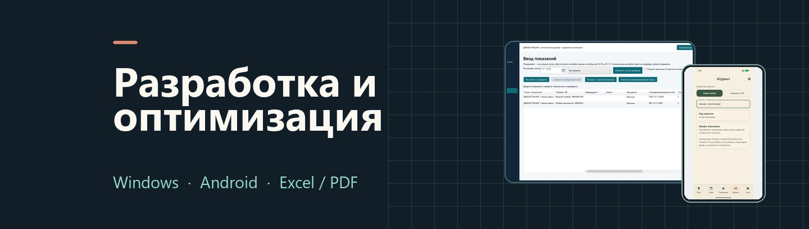
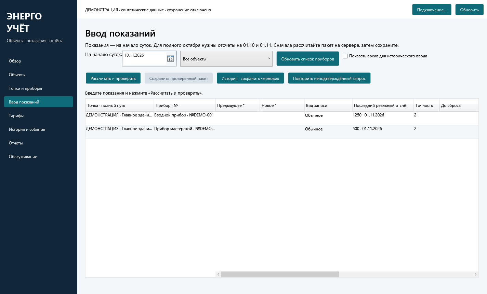
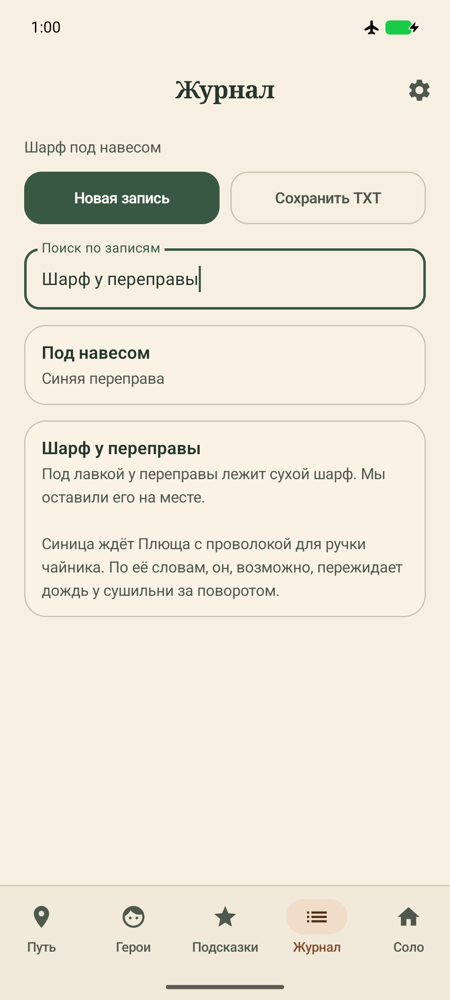

Делаю Windows-приложения для учёта, автоматизирую отчёты Excel и PDF, разрабатываю Android-приложения с локальными данными. По каждому примеру ниже видно, какой сценарий проверялся и на каком стенде.

[Реестр сроков](#реестр-сроков-для-технической-службы) · [Учёт электроэнергии](#учёт-электроэнергии-и-сверка-показаний) · [Офлайн-журнал](#офлайн-журнал-на-android)

## Избранные работы

### Реестр сроков для технической службы

C# / WPF · Учёт сроков · Excel и PDF

Собрать в одном месте сроки обучений, инструктажей, испытаний и заданий, чтобы по каждому уведомлению можно было открыть нужную запись.

Связал уведомления с карточками и историей. Добавил фильтры по сроку и состоянию, прикрепление документов и экспорт текущей выборки в Excel или PDF.

**Результат.** Переносимая WPF-сборка для Windows. Локальная приёмка на тестовых данных прошла 111 автоматических тестов и сценарии с сохранением карточек и выгрузкой.

**Что проверено.** Проверено на Windows 10. Два реальных компьютера с общей SMB-папкой, Windows 11 и физическая печать требуют отдельной приёмки.

### Учёт электроэнергии и сверка показаний

WPF · SQLite · Сверка данных

Вести историю показаний и получать сопоставимые отчёты по объектам, приборам и периодам.

Разделил ввод и проверку пакета показаний. История учитывает замену приборов и изменение коэффициентов. Для отчёта предусмотрел расчёт стоимости и сверку баланса.

**Результат.** Переносимый EXE с локальной базой, переносом базы через интерфейс и выгрузками. На раннем демонстрационном экране показан ввод показаний на тестовых данных.

**Что проверено.** Сборка проверялась на одном ПК с Windows 10 и синтетическими данными. Рабочая база и реальная сеть в эту проверку не входили.

### Офлайн-журнал на Android

Kotlin · Jetpack Compose · Профилирование

Сделать Android-приложение, в котором можно вести локальный журнал, найти запись в ходе игры и сохранить историю отдельно от приложения.

Написал интерфейс на Kotlin и Jetpack Compose. Добавил поиск, экспорт TXT и восстановление копии JSON. Для плавности переходов закешировал декодированные иллюстрации и вынес эффекты на отдельный слой.

**Результат.** Подписанный APK запущен на эмуляторах API 24, 36.1 и 37. На API 36.1 в аппаратном прогоне доля кадров с пропуском срока снизилась с 25,19% до 4,45%, а P95 кадра со 129 до 48 мс.

**Что проверено.** Сравнение сделано на одном и том же эмуляторе с аппаратной графикой. Приёмка на физическом телефоне остаётся отдельным этапом.

### Журнал отключений и восстановления

C# / WPF · Ведение журнала · Локальная проверка

Сделать журнал для дежурной службы, где можно быстро записать событие, а затем дополнить его причиной и временем восстановления.

Выделил регистрацию, поиск и закрытие события. Для нестабильной общей папки предусмотрел просмотр проверенного кеша и восстановление рабочей сессии после возвращения связи.

**Результат.** Есть переносимый клиент и инструкция. На временной базе проверены обычная кнопка сохранения, присвоение номера, обновление таблицы и сценарии возврата связи.

**Что проверено.** Локальная приёмка и SMB через localhost выполнены на одном компьютере. Работа через настоящий рабочий сервер и на Windows 11 отдельно не подтверждена.

### Отчёты Excel и PDF из рабочих журналов

XLSX · PDF · Сверка итогов

Убрать ручное копирование строк из рабочих журналов в отчёт и сохранить связь между выборкой и её итогами.

Вынес формирование отчёта в отдельный шаг. В примерах с рабочим учётом документ формируется из выбранных данных и фильтров. Excel пригоден для сверки, PDF для просмотра и передачи.

**Результат.** Выпущены экспорты для нескольких Windows-приложений. В локальных прогонах сверялись выбранные строки и содержание сформированных документов.

**Что проверено.** Проверялись тестовые данные и локальные файлы. Шаблоны и правила итогов для нового заказчика сверяются на его примере.

## Заметки о проверке проектов

- [Как я проверял плавность Android-журнала](notes/measure.md)
- [Почему в отчёте важно различать пропуск и ноль](notes/energy.md)
- [Что я проверяю в переносимой Windows-сборке](notes/windows.md)

## Как работаю

1. Согласуем один рабочий сценарий, исходные данные и результат.
2. Фиксируем, как будет проходить приёмка.
3. Сдаю сборку или файлы, инструкцию и проверку на демонстрационном наборе.
